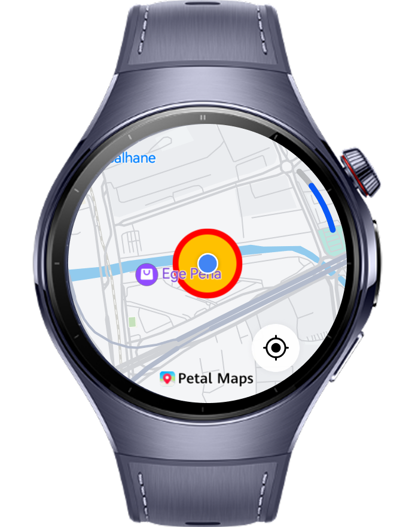
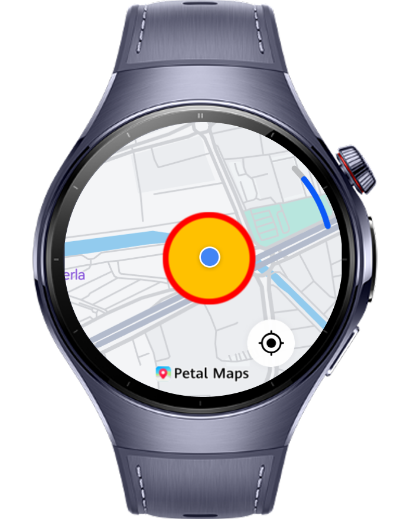

> **Note:** To access all shared projects, get information about environment setup, and view other guides, please visit [Explore-In-HMOS-Wearable Index](https://github.com/Explore-In-HMOS-Wearable/hmos-index).

# How to Create MapCircle Depends with Current Location

This guide shows how to build a MapCircle that follows the user’s current location on HarmonyOS NEXT—including support for HUAWEI Watch 5. On launch, the app requests location permission, centers the camera on the device, and renders a configurable-radius circle to visualize proximity or geofenced areas. As the user moves, the circle and (optionally) the camera update in real time across phone and wearable form factors.

# Preview

<div>
  
  
</div>

# Use Cases

1. Users can start the application and see their current location and the related MapCircle UI.
2. If user change the current location, MapCircle is updated for user's current location

# Technology

## Stack

- **Languages**: ArkTS, ArkUI
- **Frameworks**: HarmonyOS 5.1.0(18)
- **Tools**: DevEco Studio Vers 5.1.0.828SP1,
- **Libraries**: @kit.ArkUI, @kit.NetworkKit, @kit.MapKit, @kit.LocationKit

## Required Permissions

- `ohos.permission.LOCATION`
  > Required to get location information.
- `ohos.permission.APPROXIMATELY_LOCATION`
  > Required to get approximate location.
- `ohos.permission.LOCATION_IN_BACKGROUND`
  > Required to use location services in background


# Directory Structure

```
entry/src/main/ets/
├───entryability
│       EntryAbility.ets
├───entrybackupability
│       EntryBackupAbility.ets
├───pages
│       Index.ets
└───services
        LocationService
```

# Constraints and Restrictions

## Suported Devices

- Huawei Watch 5

## Limitations

- MapCircle Recreation not working on previewer or simulators
- Users need to apply location permissions and enable location in smart watch

# License

**MapCircle Recreation** is distributed under the terms of the MIT License
See the [LICENSE](../../Downloads/LICENSE) for more information.


